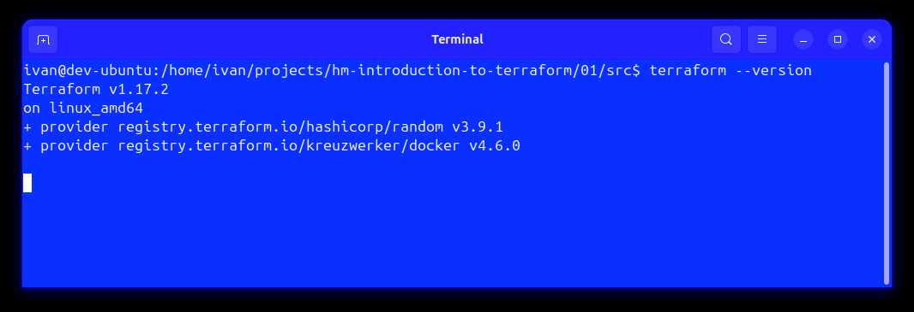

# Домашнее задание: Введение в Terraform

Исходный код задания лежит в [`01/src`](01/src). Зависимости поставлены через зеркало из `01/src/.terraformrc` (`terraform init`): провайдеры `kreuzwerker/docker` и `hashicorp/random`.

Команды ниже выполнялись Terraform **v1.12.2**, потому что в `main.tf` указано `required_version = "~>1.12.0"` (подходит только линейка 1.12.x). В системе установлен Terraform **v1.17.2**. Docker установлен (`docker version`: 29.9.2).

Вывод `terraform --version` в каталоге `01/src`:



## 1. Где хранить секреты

По `.gitignore` личные данные (логины, пароли, ключи, токены) допустимо сохранять в файле **`personal.auto.tfvars`**.

Он описан комментарием `own secret vars store` и добавлен в ignore, поэтому не попадёт в git. Terraform сам подхватывает файлы `*.auto.tfvars`.

## 2. Секрет ресурса `random_password`

После `terraform apply` в state у `random_password.random_string` секрет лежит в ключе **`result`**:

```
result = Lk9LK2k3nK6f7UvT
```

## 3. Ошибки в раскомментированном блоке

`terraform validate` на исходном блоке показал три намеренные ошибки:

1. У `resource "docker_image"` не было имени. У блока ресурса обязательны два ярлыка: тип и имя. Дальше образ используется как `docker_image.nginx`, поэтому имя ресурса — `nginx`.
2. Имя `1nginx` недопустимо. Имя ресурса должно начинаться с буквы или `_` и может содержать только буквы, цифры, `_` и `-`.
3. Ссылка `random_password.random_string_FAKE.resulT` указывает на ресурс, которого нет. Реальный адрес — `random_password.random_string.result`: имя ресурса `random_string`, атрибут `result` в нижнем регистре.

Исправленный фрагмент (`01/src/main.tf`):

```hcl
resource "docker_image" "nginx" {
  name         = "nginx:latest"
  keep_locally = true
}

resource "docker_container" "nginx" {
  image = docker_image.nginx.image_id
  name  = "hello_world"

  ports {
    internal = 80
    external = 9090
  }
}
```

`terraform validate` после правок: `Success! The configuration is valid.`

## 4. `docker ps` после первого `terraform apply`

Имя контейнера собрано из пароля, образ по-прежнему `nginx:latest`:

```
CONTAINER ID   IMAGE          COMMAND                  CREATED                  STATUS                  PORTS                  NAMES
5514ef13baf8   165ddde8751e   "/docker-entrypoint.…"   Less than a second ago   Up Less than a second   0.0.0.0:9090->80/tcp   example_Lk9LK2k3nK6f7UvT
```

## 5. Имя контейнера `hello_world` и `-auto-approve`

В блоке `docker_container` изменён аргумент `name` контейнера на `hello_world`. Имя образа не менялось: `name = "nginx:latest"` остаётся у `docker_image`.

`terraform apply -auto-approve` пересоздал контейнер. `docker ps`:

```
CONTAINER ID   IMAGE          COMMAND                  CREATED                  STATUS                  PORTS                  NAMES
0f127972a423   165ddde8751e   "/docker-entrypoint.…"   Less than a second ago   Up Less than a second   0.0.0.0:9090->80/tcp   hello_world
```

Ключ `-auto-approve` применяет план сразу и не спрашивает подтверждение. Опасность в том, что создание, замена и удаление ресурсов проходят без просмотра плана: можно снести инфраструктуру одной командой. Ключ нужен в скриптах и CI, где нет интерактивного терминала, а план уже проверен отдельно.

## 6. `terraform.tfstate` после удаления ресурсов

Ресурсы удалены командой `terraform destroy`. `docker ps` после этого пустой. Содержимое `01/src/terraform.tfstate`:

```json
{
  "version": 4,
  "terraform_version": "1.12.2",
  "serial": 11,
  "lineage": "a7645506-25d6-e9df-9801-2e089038532e",
  "outputs": {},
  "resources": [],
  "check_results": null
}
```

Пустой список `resources` значит, что Terraform больше не отслеживает созданные объекты.

## 7. Почему образ `nginx:latest` не удалился

В коде ресурса явно задано сохранение образа на хосте:

```hcl
resource "docker_image" "nginx" {
  name         = "nginx:latest"
  keep_locally = true
}
```

Документация провайдера `kreuzwerker/docker`, ресурс `docker_image`, аргумент `keep_locally`:

> If true, then the Docker image won't be deleted on destroy operation. If this is false, it will delete the image from the docker local storage on destroy operation.

Поэтому `terraform destroy` удалил ресурс из state и остановил контейнер, а локальный образ `nginx:latest` остался. Это подтверждалось `docker images`: тег `nginx:latest` был на месте.
